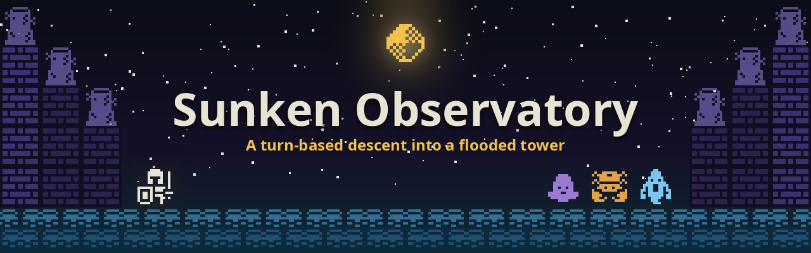
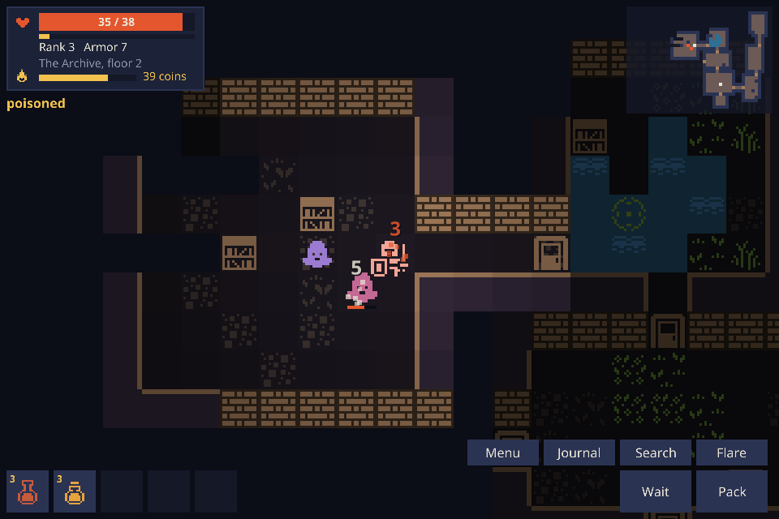
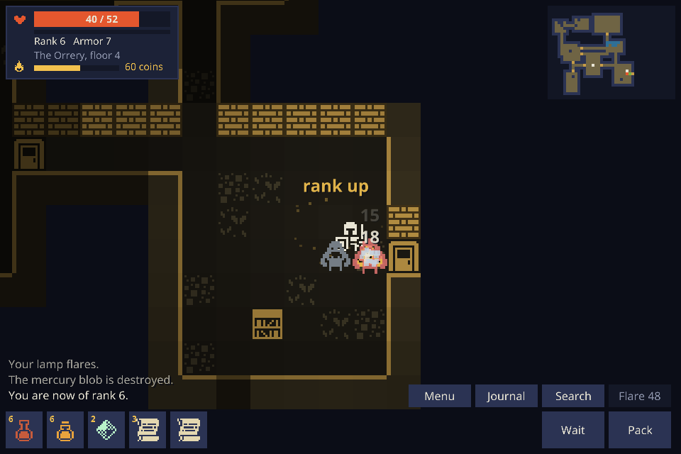
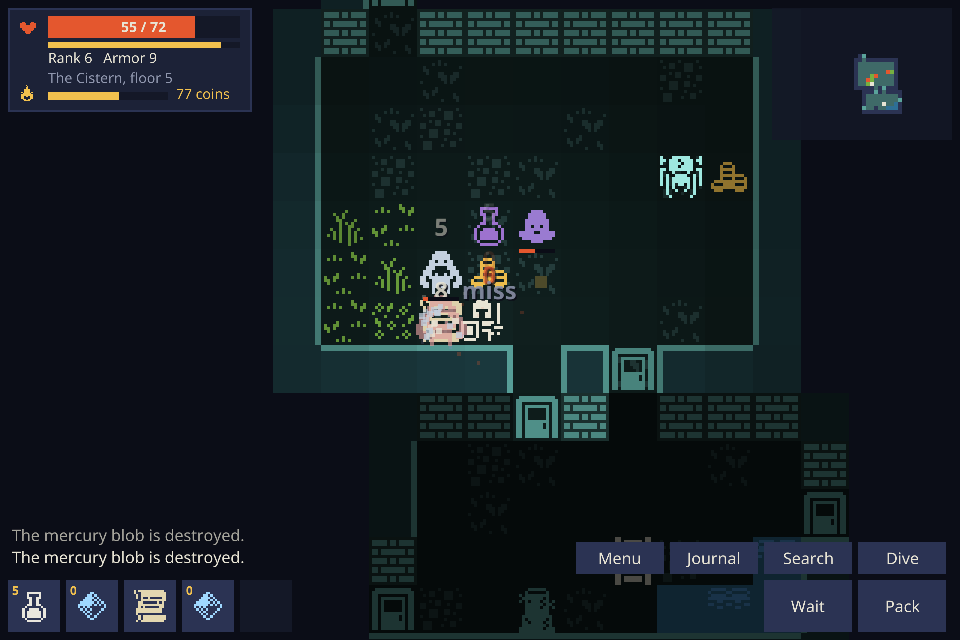
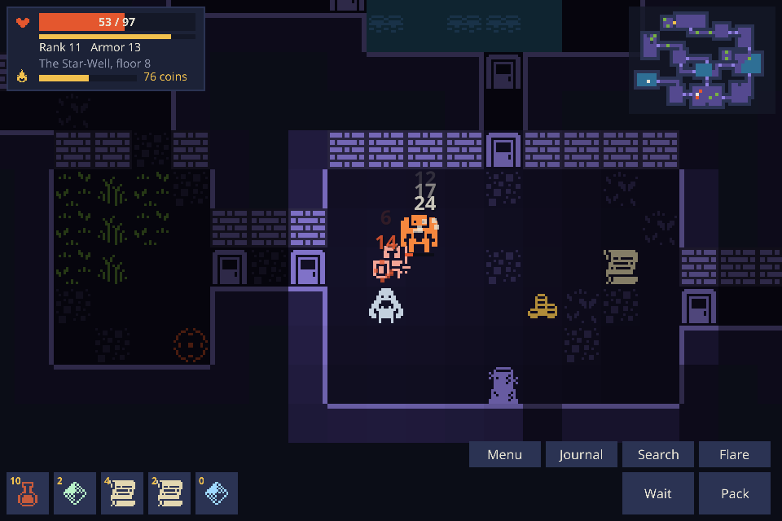
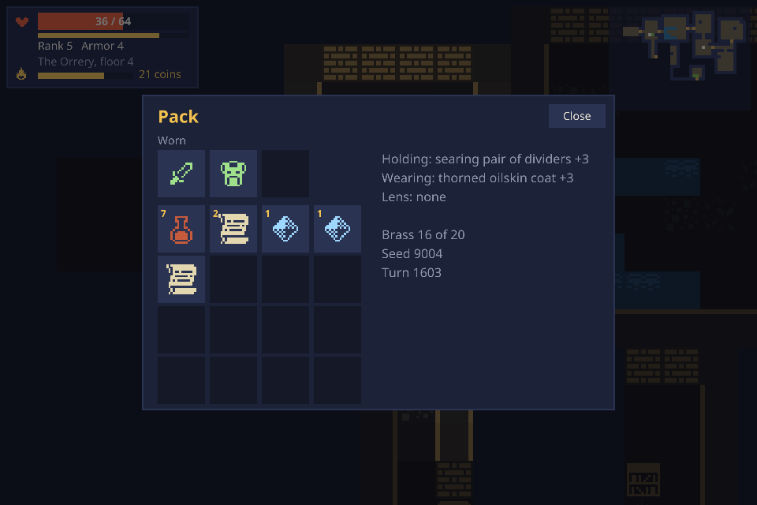
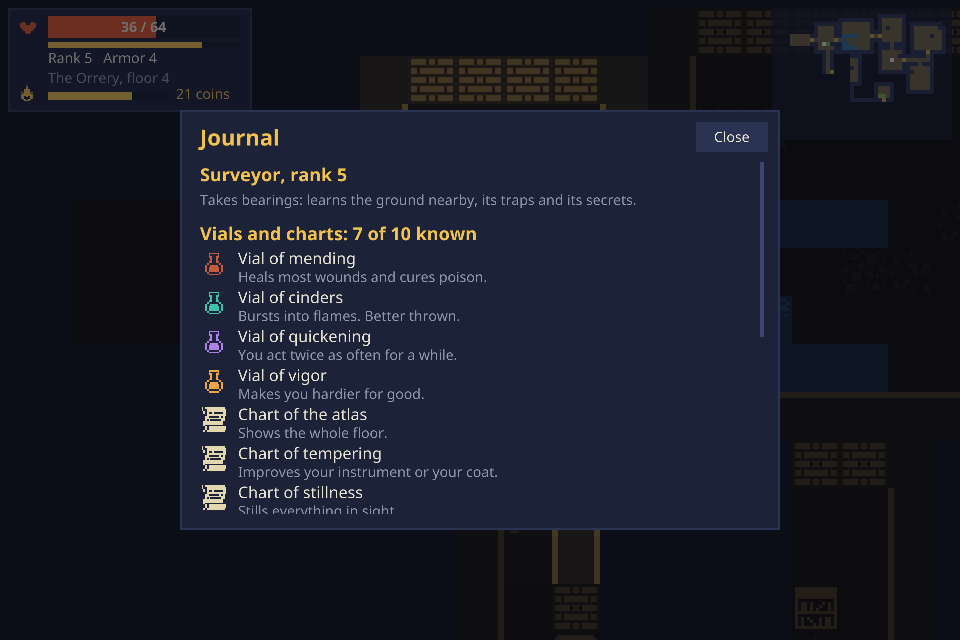

**[Play it in the browser](https://regb.github.io/sunken-observatory/)**

A turn-based dungeon crawl: eight generated floors that stay as they are left,
three callings, unidentified vials and charts, prisms, etched and cursed gear,
vaults, hidden rooms and a trader, keepers of the stairs, fire, miasma and
tides. The Lodestar is at the bottom, and has to be carried back out while the
tower floods.

It is written in Scala with [SGL](https://github.com/regb/scala-game-library)
and its GameObject engine, and runs on the desktop (JVM and native) and in the
browser from the same code.

| | |
| --- | --- |
|  |  |
|  |  |
|  |  |

## Playing

Tap or click to walk and fight, or use the arrows or WASD, with Q, E, Z and C
for diagonals. Space waits, G takes or goes down, F searches, R uses your
ability, I opens the pack, J the journal, 1 to 5 use what is first in the pack,
and the wheel or a pinch zooms.

## Building

It builds with [Bazel](https://bazel.build/): install
[Bazelisk](https://github.com/bazelbuild/bazelisk), which downloads the pinned
Bazel, and Bazel downloads the rest.

    bazel run //:desktop-lwjgl     # a window, on the JVM
    bazel run //:html5             # http://localhost:8080
    bazel run //:desktop-native    # needs clang, SDL2, SDL2_image and OpenGL ES
    bazel test //...

SGL is pinned to a commit in `MODULE.bazel`; to upgrade, change `commit`.

- `model/` has the rules and does not depend on SGL. A game follows from its
  seed and the commands performed, the same on every platform.
- `view/` shows it on the GameObject engine: tilemaps for the floor, an object
  for each actor, and an interface drawn with `Painter2D`.
- `test/` plays whole games by key on the headless backend, and compares them
  with the same games played by the rules alone.

How hard it is comes from `model/Tuning.scala`, and is measured by bots that
play many games, one carelessly and one well:

    bazel run //:balance -- 300 expert 1000

The last number is the first seed: try others than those a change was made for.
The one that plays well is meant to win between a third and a half of its games.

## Credits

It began as a test of SGL on a game like
[Shattered Pixel Dungeon](https://github.com/00-Evan/shattered-pixel-dungeon),
itself built on Watabou's [Pixel Dungeon](https://github.com/watabou/pixel-dungeon):
a turn-based descent, with floors that stay, items to identify, and the way
back up. It follows their genre with its own rules, story and art, and uses
none of their code or assets.

The code is under the MIT license, see `LICENSE`. The tiles are from
[Kenney's 1-Bit Pack](https://kenney.nl/assets/1-bit-pack), CC0, see
`assets/KENNEY-1-BIT-PACK-LICENSE.txt`. The sounds and the music were
synthesized for this game. The banner and `docs/feature-graphic.png` are drawn
from the same tiles by `docs/make_art.py`, and the screenshots are of the game.
